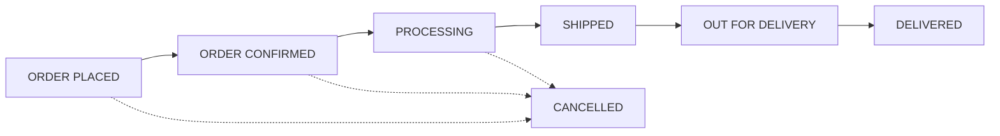

# 🌿 MITAHARA – Complete Production-Ready MERN Stack E-Commerce

> **"Mitāhāra" (मिताहार)** — *The ancient yogic virtue of wholesome, balanced, and mindful nutrition.*  
> Inspired by the visual identity, brand ethos, and categories of [mitahara.online](https://mitahara.online/).

MITAHARA is a full-featured, enterprise-grade e-commerce application crafted for organic, farm-fresh, and ayurvedic wellness products. It combines a natural, organic visual identity with an immutable checkout calculation engine, internal order milestone tracking via real-time WebSockets, atomic coupon validations, and marketing campaign attribution analytics.

---

## 📑 Table of Contents
1. [Key Features](#-key-features)
2. [Technology Stack](#-technology-stack)
3. [Centralized Design System](#-centralized-design-system)
4. [Checkout Calculation Formula](#-checkout-calculation-formula)
5. [Order Milestone Tracking](#-order-milestone-tracking)
6. [Coupon Management Engine](#-coupon-management-engine)
7. [Marketing Analytics & Attribution](#-marketing-analytics--attribution)
8. [Architecture & Project Structure](#-architecture--project-structure)
9. [Setup & Installation](#-setup--installation)
10. [Default Credentials & Seed Data](#-default-credentials--seed-data)
11. [REST API Documentation](#-rest-api-documentation)

---

## ✨ Key Features

### 🛒 Storefront & Customer Experience
- **Guest Browsing & Intentional Gates**: Visitors can explore all products, categories, benefits, and stories freely. Adding to cart, managing wishlists, checkout, and order tracking require a 6-digit email OTP verification that returns users immediately to their intended destination.
- **Session-Stable Featured Products**: Shuffles featured products pseudo-randomly using a session seed, guaranteeing that selections remain stable throughout a user's browsing session rather than flickering on every page refresh.
- **Categorized Wellness Catalog**: Directly aligned with `mitahara.online` product verticals:
  1. *Rotis & Healthy Breads* (Ragi, Multigrain, Jowar)
  2. *Millet Breakfasts* (Foxtail Idli mix, Millet Upma, Barnyard Dosa batter)
  3. *Oatmeal & Porridge* (Sprouted Rolled Oats, Chia Overnight Oats)
  4. *Cold-Pressed Juices* (Amla Detox, Beetroot Pomegranate, Green Elixir)
  5. *Wholesome Curries & Dal* (Sprouted Moong Curry, Moringa Dal)
  6. *Fresh Salads & Bowls* (Quinoa Sprout Bowl, Microgreen Medley)
  7. *Unpolished Millets & Grains* (Kodo, Little, Foxtail, Barnyard)
  8. *Superfoods & Dry Fruits* (Kashmiri Raw Honey, 7-Seed Mix, A2 Ghee)
- **MongoDB-Persisted Cart**: Preserved across user sessions and synchronized directly upon login.
- **Rich Product Details**: Multiple image thumbnails, key health benefits, dietary badges (Organic, Vegan, Gluten-Free, Sugar-Free), and related item recommendations.

### 🔐 Security & Email OTP Authentication
- **Passwordless Authentication**: Users enter their email and receive a secure 6-digit OTP powered by Nodemailer and Gmail SMTP (`manoharthappetla@gmail.com`).
- **Cryptographic Storage**: OTPs are hashed using SHA-256 before storage in MongoDB.
- **Strict Lifecycles**: 5-minute automatic expiration with MongoDB TTL indexes, single-use invalidation, 60-second resend cooldown timer, and 5-attempt rate-limit cutoff.
- **Token Security**: Dual-token architecture with secure HTTP-only cookies and Authorization Bearer headers with automatic refresh.

### 📦 Milestone Order Tracking (Internal & Non-GPS)
- **Vertical Visual Timeline**: Order milestones clearly rendered with active, completed, and pending states:
  1. `ORDER PLACED`
  2. `ORDER CONFIRMED`
  3. `PROCESSING`
  4. `SHIPPED`
  5. `OUT FOR DELIVERY`
  6. `DELIVERED`
  - Separate terminal state: `CANCELLED`.
- **Real-Time Socket.IO Synchronization**: Customers in their dedicated tracking room receive immediate milestone updates without refreshing. Polling fallback runs automatically every 15 seconds.
- **Admin Order Management**: Administrators can update statuses, add customer-visible notes, set courier names (`Mitahara Green Express`), courier tracking numbers, and estimated delivery dates. Status changes automatically trigger branded HTML emails.

---

## 🛠 Technology Stack

### Frontend
- **Framework**: React 18 with TypeScript & Vite
- **Styling**: Tailwind CSS & CSS Custom Properties (Centralized Design System)
- **State Management**: Redux Toolkit (`authSlice`, `cartSlice`, `productsSlice`, `ordersSlice`, `uiSlice`)
- **Routing**: React Router DOM v7
- **HTTP Client**: Axios with automatic 401 interceptors and global error handling
- **Real-Time Client**: Socket.IO Client
- **Charts & Visuals**: Recharts (Revenue curves, Orders bar charts, Customer distribution, Category breakdowns)
- **Icons**: Lucide React
- **Forms & FX**: React Hook Form, Canvas Confetti

### Backend
- **Runtime & Language**: Node.js, Express.js with TypeScript (`tsx` runtime)
- **Database**: MongoDB with Mongoose ORM
- **Zero-Config Development**: Automatic in-memory embedded database fallback (`mongodb-memory-server`) if `MONGO_URI` is omitted
- **Authentication**: JWT (`jsonwebtoken`) & SHA-256 OTP hashing
- **Mailing**: Nodemailer with Gmail SMTP (`manoharthappetla@gmail.com`)
- **Real-Time Engine**: Socket.IO server with room-based pub/sub
- **Security Suite**: Helmet, CORS, Express Rate Limit (`express-rate-limit`), Cookie Parser
- **Validation**: Zod schema validation middleware

---

## 🎨 Centralized Design System

Located in [frontend/src/styles/index.css](file:///c:/Users/user/Desktop/Mitahara/frontend/src/styles/index.css) and [frontend/tailwind.config.js](file:///c:/Users/user/Desktop/Mitahara/frontend/tailwind.config.js):

| Design Token | Value | Description |
| :--- | :--- | :--- |
| **Primary Color** | `#15803d` / `#166534` | Forest Green / Deep Vedic Emerald (health, vitality) |
| **Secondary Color** | `#d97706` / `#b45309` | Golden Amber / Turmeric Honey (warmth, harvest) |
| **Accent Color** | `#84cc16` / `#65a30d` | Fresh Lime / Herb Sprout (nature, fresh energy) |
| **Background Color** | `#fdfbf7` | Warm Ivory / Natural Parchment (organic cleanliness) |
| **Surface / Card** | `#ffffff` | Pure White with subtle warm border (`#e2d9cc`) |
| **Text Primary** | `#0f172a` | Deep Charcoal Slate (readability and contrast) |
| **Text Muted** | `#64748b` | Soft Warm Gray |
| **Borders** | `#e2d9cc` / `#cbd5e1` | Soft earthen separation lines |
| **Typography** | `Plus Jakarta Sans`, `Crimson Text` | Modern clarity paired with classic organic serif headers |

---

## 💰 Checkout Calculation Formula

All pricing rules are strictly validated on the backend. Frontend prices and discounts are never trusted.

$$\text{Subtotal} = \sum (\text{Product Snapshotted Price} \times \text{Quantity})$$
$$\text{Delivery Charge} = ₹24 \quad (\text{Fixed per order})$$
$$\text{GST} = ₹0 \quad (\text{Zero tax charged})$$
$$\text{Grand Total} = \text{Subtotal} + ₹24 - \text{Coupon Discount}$$

### Example Verification
- **Cart**:
  - Item A: $₹200 \times 2 = ₹400$
  - Item B: $₹150 \times 1 = ₹150$
  - **Subtotal** = $₹550$
- **Delivery**: $₹24$
- **GST**: $₹0$
- **Coupon (`SAVE50`)**: $-₹50$
- **Final Grand Total**: $₹550 + ₹24 - ₹50 = \mathbf{₹524}$

---

## 🚚 Order Milestone Tracking

Orders progress through six verified stages with visual completion indicators:



- Each milestone stores: `status`, `message`, `timestamp`, `updatedBy`, `courierName`, `trackingNumber`, and `estimatedDeliveryDate`.
- Updates broadcast instantaneously to the customer's active Socket.IO room (`order:<orderId>`).
- Customers can track live via [My Orders](file:///c:/Users/user/Desktop/Mitahara/frontend/src/pages/user/MyOrdersPage.tsx) and the dedicated [Order Tracking Page](file:///c:/Users/user/Desktop/Mitahara/frontend/src/pages/user/OrderTrackingPage.tsx).

---

## 🎟 Coupon Management Engine

Coupons are managed from the Admin Dashboard with strict concurrency and fraud protection:
- **Discount Types**: Percentage (`%`), Fixed Amount (`₹`), or Free Delivery.
- **Concurrency Protection**: Atomic MongoDB updates (`$inc: { timesUsed: 1 }`) prevent race conditions from exceeding max usage limits.
- **User Limits**: Per-user usage tracking prevents repeated exploitation.
- **Historical Snapshotting**: The applied coupon metadata is saved inside the immutable Order record, ensuring financial reports remain accurate if coupon rules change later.

### Pre-Seeded Promotional Coupons
- `WELCOME10`: 10% off entire order (Min order ₹300, max discount ₹150).
- `SAVE50`: Flat ₹50 off on orders of ₹250 or more.
- `MITAHARA20`: 20% off for wellness connoisseurs (Min order ₹500, max discount ₹200).

---

## 📊 Marketing Analytics & Attribution

Administrators have access to a dedicated analytics suite built with Recharts:
- **Date Filters**: `Today`, `Last 7 Days`, `Last 30 Days`, `Last 90 Days`, `This Month`, and `Custom Date Range`.
- **Key Performance Indicators (KPIs)**:
  - Total Revenue & Total Orders
  - Total Registered Customers & New Registrations
  - Average Order Value (AOV)
  - Repeat Customer Rate (%)
  - Coupon Redemption Rate & Total Discounts Granted
- **UTM Campaign Attribution**: Captures `utm_source`, `utm_medium`, and `utm_campaign` from visitor entry query strings and records attribution upon checkout.
- **One-Click CSV Exports**:
  - Export Orders CSV with complete financial and shipping snapshots.
  - Export Customers CSV with location and spend metrics.

---

## 📁 Architecture & Project Structure

```
Mitahara/
├── package.json              # Root build & dev scripts
├── .gitignore                # Workspace git ignore
├── backend/
│   ├── .env.example          # Environment variables template
│   ├── tsconfig.json         # TypeScript configuration
│   ├── src/
│   │   ├── config/           # Database, Env, Nodemailer & Socket.IO config
│   │   ├── controllers/      # Auth, Products, Orders, Cart, Coupons, Analytics
│   │   ├── middleware/       # JWT RBAC, Rate-Limiting, Error Handling, Zod
│   │   ├── models/           # User, Product, Category, Cart, Order, Coupon, etc.
│   │   ├── routes/           # REST endpoints
│   │   ├── utils/            # Hashing, Order numbering, Seed data, Email templates
│   │   ├── validators/       # Zod schemas for auth, orders, coupons
│   │   ├── app.ts            # Express app configuration
│   │   └── server.ts         # Server entrypoint with Socket.IO
└── frontend/
    ├── .env.example          # Frontend configuration
    ├── index.html            # HTML entry point with fonts & meta
    ├── vite.config.ts        # Vite configuration with backend proxy
    ├── tailwind.config.js    # Tailwind config with Mitahara design tokens
    ├── src/
    │   ├── components/       # Navbar, Footer, ProductCard, OrderTimeline, AuthModal
    │   ├── layouts/          # MainLayout (with UTM capture), AdminLayout
    │   ├── pages/
    │   │   ├── user/         # Home, Products, ProductDetail, Cart, Checkout, Tracking
    │   │   └── admin/        # Overview, Products, Orders, Tracking, Coupons, Analytics
    │   ├── services/         # Axios API client & Socket.IO client
    │   ├── store/            # Redux Toolkit slices (Auth, Cart, Products, Orders, UI)
    │   ├── styles/           # Centralized CSS Design System
    │   ├── types/            # TypeScript interfaces
    │   ├── App.tsx           # Main application router wrapper
    │   └── main.tsx          # Application entry point
```

---

## 🚀 Setup & Installation

### Prerequisites
- Node.js (v18.x or v20.x recommended)
- npm or yarn

### 1. Quick Start (From Root)
Clone or navigate to the project directory:
```bash
cd c:/Users/user/Desktop/Mitahara
```

Install backend and frontend dependencies:
```bash
# In backend
cd backend
npm install

# In frontend
cd ../frontend
npm install
```

### 2. Configure Environment Variables

**Backend (`backend/.env`):**
```env
PORT=5000
NODE_ENV=development
FRONTEND_URL=http://localhost:3000

# Optional: MongoDB Atlas URI. 
# If left empty, an embedded MongoDB Memory Server starts automatically for zero-config local run!
MONGO_URI=

# JWT Secrets
JWT_SECRET=mitahara_super_secret_jwt_key_2026_health_organic
JWT_EXPIRES_IN=7d
REFRESH_TOKEN_SECRET=mitahara_super_secret_refresh_jwt_key_2026
REFRESH_TOKEN_EXPIRES_IN=30d

# SMTP Gmail Configuration
SMTP_HOST=smtp.gmail.com
SMTP_PORT=587
SMTP_USER=manoharthappetla@gmail.com
SMTP_PASS=your_gmail_app_password_here
SMTP_FROM="MITAHARA Pure Organic" <manoharthappetla@gmail.com>
```

> **Note on Gmail SMTP**: If `SMTP_PASS` is empty during local development, the backend automatically uses a safe simulation transport: it logs the generated 6-digit OTP to the server console and surfaces `devOtp` in the API response for testing. In production, provide a standard [Google App Password](https://myaccount.google.com/apppasswords).

**Frontend (`frontend/.env`):**
```env
VITE_API_BASE_URL=http://localhost:5000/api/v1
VITE_SOCKET_URL=http://localhost:5000
```

### 3. Run Development Servers

**Option A — Run both concurrently from root:**
```bash
# Start backend in one terminal
npm run dev:backend

# Start frontend in another terminal
npm run dev:frontend
```

- Backend API: `http://localhost:5000`
- Frontend UI: `http://localhost:3000` (or `http://localhost:5173`)

---

## 👤 Default Credentials & Seed Data

The database automatically seeds on first boot with:
- **8 Categories** directly matched to `mitahara.online`
- **12 Organic Wellness Products** with descriptions, benefits, prices, and stock
- **3 Active Promotional Coupons** (`WELCOME10`, `SAVE50`, `MITAHARA20`)
- **2 Sample Orders** with complete tracking status history

### Pre-Configured Accounts:
| Role | Email | Access |
| :--- | :--- | :--- |
| **Administrator** | `admin@mitahara.online` | Full access to Admin Dashboard, Analytics, Orders, Coupons, and Products |
| **Sample Customer** | `customer@mitahara.online` | Sample user with existing order history |

To sign in as Admin:
1. Click **Sign In** in the navigation bar.
2. Enter `admin@mitahara.online`.
3. In development mode, the OTP is pre-filled or visible in the dev hint card. Click **Verify Code** to immediately access the Admin Dashboard.

---

## 📡 REST API Documentation

### Authentication (`/api/v1/auth`)
| Method | Endpoint | Description | Access |
| :--- | :--- | :--- | :--- |
| `POST` | `/send-otp` | Generate and dispatch 6-digit OTP | Public |
| `POST` | `/verify-otp` | Verify OTP, issue tokens & authenticate | Public |
| `POST` | `/logout` | Clear auth cookies & sessions | Authenticated |
| `GET` | `/me` | Get current user profile | Authenticated |

### Products & Categories
| Method | Endpoint | Description | Access |
| :--- | :--- | :--- | :--- |
| `GET` | `/api/v1/products` | Filter, search, paginate products | Public |
| `GET` | `/api/v1/products/featured`| Session-stable featured products | Public |
| `GET` | `/api/v1/products/:id` | Get product details & related items | Public |
| `GET` | `/api/v1/categories` | List all 8 wellness categories | Public |

### Cart & Checkout
| Method | Endpoint | Description | Access |
| :--- | :--- | :--- | :--- |
| `GET` | `/api/v1/cart` | Get user's persisted MongoDB cart | Customer |
| `POST` | `/api/v1/cart/items` | Add or increment product in cart | Customer |
| `PUT` | `/api/v1/cart/items/:id` | Update product quantity | Customer |
| `DELETE`| `/api/v1/cart/items/:id` | Remove item from cart | Customer |
| `POST` | `/api/v1/coupons/validate`| Validate coupon & preview totals | Customer |
| `POST` | `/api/v1/orders/checkout` | Place order with server calculations | Customer |

### Order Tracking
| Method | Endpoint | Description | Access |
| :--- | :--- | :--- | :--- |
| `GET` | `/api/v1/user/orders` | Customer's order history | Customer |
| `GET` | `/api/v1/user/orders/:id/tracking` | Dedicated vertical tracking data | Customer |
| `PATCH` | `/api/v1/admin/orders/:id/status` | Update milestone, courier & notes | Admin |

### Admin & Analytics (`/api/v1/admin`)
| Method | Endpoint | Description | Access |
| :--- | :--- | :--- | :--- |
| `GET` | `/analytics/overview` | KPI summaries & Recharts datasets | Admin |
| `GET` | `/analytics/export/orders` | Download orders CSV | Admin |
| `GET` | `/analytics/export/customers` | Download customers CSV | Admin |
| `POST` | `/coupons` | Create new discount coupon | Admin |
| `PATCH` | `/coupons/:id/toggle` | Toggle coupon active status | Admin |
| `POST` | `/products` | Create new wellness product | Admin |

---

## 🛡 License
MIT © 2026 MITAHARA. All rights reserved.
